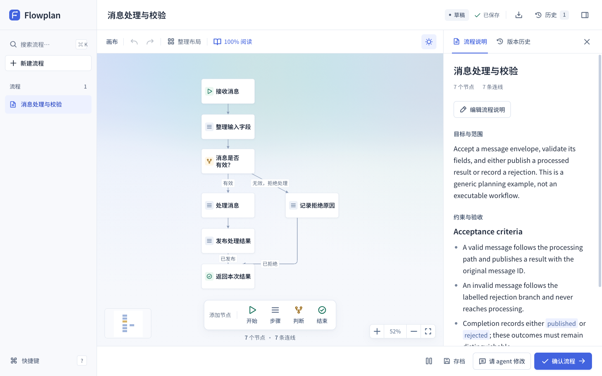

# Flowplan

[English](README.md) · [简体中文](README.zh-CN.md)

Plan a coding task with an editable flowchart before your agent writes code.

Draw the core flow yourself or ask your agent for a first draft. Open it in your browser, fix the branches, add the details, and approve a version to build from. Flowplan is installed as the `diagram-plan` skill.



## Install

Run this in your project with the [skills CLI](https://github.com/vercel-labs/skills):

```sh
npx skills add dingdinglz/diagram-skill --skill diagram-plan
```

Choose your agent when prompted. Then ask it:

> Use diagram-plan to plan this task before coding. Draft the core flow and open the canvas for me to review.

You need macOS or Linux, Python 3.8+, and a local desktop browser. The editor comes prebuilt. The command above uses Node.js; you can also [install manually](docs/usage.md#manual-installation) without it.

The editor UI is currently in Chinese. You can write the diagram and its notes in your preferred language.

## How it works

1. Start with a blank canvas, or let the agent read the relevant code and propose a flow.
2. Edit the nodes, connections, and branch conditions. Put field tables, examples, and constraints in node notes so the main flow stays readable.
3. Send feedback if you want the agent to revise the diagram. It is instructed to keep your existing structure and layout where possible.
4. Approve the version you want implemented. The agent reads that version's graph, notes, and PNG before coding.

Drafts save automatically. Undo and redo handle small mistakes; saved versions let you revisit earlier plans without overwriting an approval. If your agent has stopped waiting, return to the conversation and ask it to continue the diagram task.

Each approval saves `diagram.json`, `diagram.md`, and `diagram.png`. The PNG includes the full flow and all note cards, even when they were collapsed on the canvas. [View a sample export](docs/images/plan-export.png).

## The editor

- **Canvas:** switch between the main flow and its branches, add nodes from the bottom toolbar, and use “100% 阅读” to read cards at full size.
- **Details:** read flow descriptions and node notes as Markdown in the side panel. Enter editing mode when you want to make changes.
- **Navigation and history:** search your flows in the left sidebar, check save status, and open version history without leaving the workspace.

The light interface uses locally bundled Noto Sans SC and Phosphor icons. Canvas background motion can be paused and respects reduced-motion preferences. On narrow screens, navigation and details open as dismissible panels. [See the mobile reader](docs/images/editor-mobile.png).

## Try the canvas

You can try the editor without installing the skill or connecting an agent:

```sh
git clone https://github.com/dingdinglz/diagram-skill.git
cd diagram-skill

python3 skills/diagram-plan/scripts/diagram.py create \
  --project "$PWD" --title "Message processing" --mode agent \
  --graph "$PWD/examples/sample-flow.json"
```

This opens the bundled example in your browser. To start with an empty canvas, leave out `--graph` and use `--mode manual`.

## Why I made this

I tried drawing a task's core flow on a whiteboard and giving it to a coding agent. That worked better than explaining the same flow in a long text plan. I wanted to keep drawing and revising the plan as part of the coding workflow, with a saved version that both the user and agent could refer to.

## Local files, your existing agent

The canvas runs on localhost and stores plans under `.diagram-skill/` in your project. Add that directory to your project's `.gitignore`. The editor doesn't upload plans or ask for a model API key; your coding agent's usual model and data settings still apply.

## Docs

- [Usage, manual installation, and troubleshooting](docs/usage.md)
- [Development and testing](CONTRIBUTING.md)
- [CLI reference](skills/diagram-plan/references/cli.md)
- [Graph format](skills/diagram-plan/references/graph-schema.md) and [diagram guidelines](skills/diagram-plan/references/design.md)

The canvas uses [React Flow](https://reactflow.dev/). The diagram guidelines draw on [diagram-design](https://github.com/cathrynlavery/diagram-design).

## License

Original project code: [MIT](LICENSE). Third-party code and fonts retain their own licenses, including **MIT + Commons Clause** for the React Bits adaptations and **SIL OFL-1.1** for bundled Noto Sans SC. See [third-party notices](skills/diagram-plan/THIRD_PARTY_NOTICES.md).
