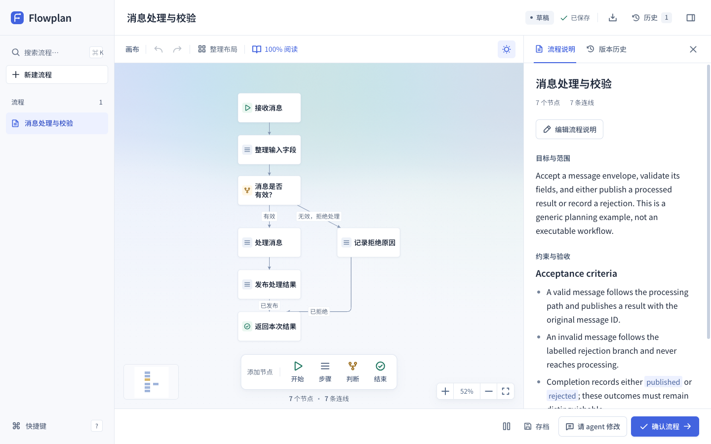

# Flowplan

[English](README.md) · [简体中文](README.zh-CN.md)

先把任务画清楚，再让 coding agent 写代码。

你可以自己画核心流程，也可以让 agent 先出一版。在浏览器里调整分支、补充细节，确认后再按图实现。安装时使用的 skill 名称是 `diagram-plan`。



## 安装

在你的项目目录里，通过 [skills CLI](https://github.com/vercel-labs/skills) 安装：

```sh
npx skills add dingdinglz/diagram-skill --skill diagram-plan
```

按提示选择你使用的 agent，然后告诉它：

> 用 diagram-plan 规划这个任务，先不要写代码。画出核心流程，打开画板让我修改和确认。

需要 macOS 或 Linux、Python 3.8+ 和本机浏览器。网页已经构建好，使用时不用编译前端。上面的安装命令需要 Node.js；如果不想安装 Node，可以[手动安装](docs/usage.md#manual-installation)。

编辑器目前是中文界面，图里的标题和说明可以使用其他语言。

## 怎么用

1. 从空白画布开始，或者让 agent 阅读相关代码后生成初稿。
2. 修改节点、连线和分支条件。字段表、示例、约束放进节点说明，主线不用挤满文字。
3. 想让 agent 帮忙调整，就提交修改意见。Skill 会要求它尽量保留你已经整理好的结构和布局。
4. 确认准备实施的版本。Agent 读取这一版的图、说明和 PNG，再开始写代码。

草稿会自动保存，编辑时可以撤销、重做。也可以查看历史，把旧版本恢复成新草稿，已经确认的版本不会被覆盖。如果 agent 已经结束等待，回到聊天里让它继续这个画图任务即可。

每次确认都会保存 `diagram.json`、`diagram.md` 和 `diagram.png`。PNG 包含完整流程和所有说明卡片，不会因为画布缩放或卡片折叠而漏掉内容。[查看导出示例](docs/images/plan-export.png)。

## 编辑器界面

- **画布**：切换主线与分支，从底部工具栏添加节点，点击「100% 阅读」查看原尺寸卡片。
- **详情**：在侧栏阅读 Markdown 格式的流程描述和节点说明，需要修改时再进入编辑模式。
- **导航与历史**：在左侧搜索流程，随时查看保存状态和版本历史，不用离开当前工作区。

浅色界面内置 Noto Sans SC 字体和 Phosphor 图标，无需在线加载。画布背景动效可以暂停，也会遵循系统的「减少动态效果」设置。窄屏下，导航与详情会变为可关闭的面板。[查看手机端阅读界面](docs/images/editor-mobile.png)。

## 先试试画板

不安装 skill、不连接 agent，也可以先打开示例体验：

```sh
git clone https://github.com/dingdinglz/diagram-skill.git
cd diagram-skill

python3 skills/diagram-plan/scripts/diagram.py create \
  --project "$PWD" --title "Message processing" --mode agent \
  --graph "$PWD/examples/sample-flow.json"
```

命令会在浏览器中打开示例图。想从零开始，去掉 `--graph`，把模式改成 `--mode manual`。

## 为什么做这个

之前做一个任务时，我先在白板上画了核心链路，再把图交给 coding agent。效果比写一大段文字 plan 好很多。所以我想把画图、修改和确认接进 coding 的流程里，也留下一份双方都能回看的版本。

## 数据放在哪里

画板在本机运行，规划文件保存在项目的 `.diagram-skill/` 目录。请把这个目录加入项目的 `.gitignore`。编辑器不会上传规划内容，也不需要额外的模型 API key；agent 读取这些文件之后，仍按你原来的模型和数据设置工作。

## 文档

- [使用说明、手动安装与常见问题](docs/usage.md)（英文）
- [开发与测试](CONTRIBUTING.md)（英文）
- [CLI 命令](skills/diagram-plan/references/cli.md)
- [图的数据格式](skills/diagram-plan/references/graph-schema.md)与[绘图规范](skills/diagram-plan/references/design.md)

画布基于 [React Flow](https://reactflow.dev/)，绘图规范参考了 [diagram-design](https://github.com/cathrynlavery/diagram-design)。

## 许可证

项目原创代码采用 [MIT 许可证](LICENSE)。第三方代码和字体保留各自的许可证，包括 React Bits 改编组件的 **MIT + Commons Clause** 与内置 Noto Sans SC 的 **SIL OFL-1.1**。详见[第三方许可声明](skills/diagram-plan/THIRD_PARTY_NOTICES.md)。
