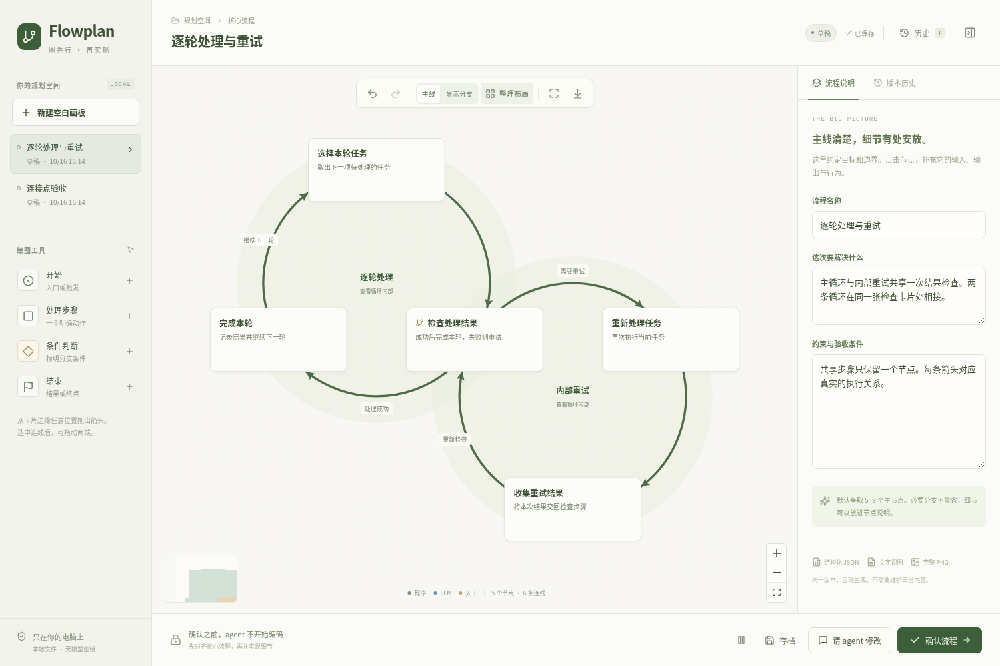

# 流程图可读性与循环交互

主画布优先呈现主要行为和循环。异常、次要分支和普通子流程保留可见入口，读者可以在右侧查看它们的条件、步骤和结果。

## 数据与分组

Graph v2 保留原始节点和边，增加卡片摘要、主次分类、分组、圆环位置和可选连接点。字段与校验规则见 [graph-schema.md](../../skills/diagram-plan/references/graph-schema.md)。

- 节点和连线的 `role` 区分主线、次要步骤与异常处理，由作者根据行为明确指定。
- 分组可以共享真实节点。一个节点 ID 对应一张卡片和一个位置。
- 父子关系表达逻辑层级，子组成员仍须包含在父组内。
- 循环 `order` 描述真实闭合路径，可以包含节点或不重叠的子组槽位。共享节点的子组应使用真实节点 ID 表达路径。
- 删除或改接必要的循环边后，将失效的循环标记改为普通子流程，保留其余数据。

v1 图在读取、导出和恢复时保持原版本。历史快照不可改写；批准检查始终覆盖完整图，包括当前隐藏的判断和分支。

## 循环布局与连线

循环步骤围成圆环，文字保持正向，箭头从圆周与圆角卡片的交点连接到下一步。主线使用较粗实线，主循环进一步加粗；次要连线较细，异常连线使用虚线。

嵌套循环直接显示，可放在父循环外侧。有一个真实共享节点时，两圈在这一张卡片处相切。入口和出口不同时保留各自的真实连线；多个共享节点可能无法形成精确相切圆，此时保留单一节点位置和真实执行关系。

`group.circle` 保存圆心和半径。主动整理布局时重新排圆；拖动共享节点只移动该节点，其余卡片保持原位，连线随之调整。普通阅读、刷新和自动保存不触发布局。

连线起止点可以位于整个圆角卡片边缘。省略锚点时自动选择位置；手动拖动后保存相对卡片的归一化坐标。拖动预览不保存，松手后生成一次可撤销的修改。选择连线后也可以恢复自动连接点。

## 固定详情栏与编辑

卡片显示动作标题和一句简短说明；判断、人工和 LLM 标记各有固定位置。重复的程序标签在主画布省略，完整执行者信息保留在详情里。

点击卡片在右侧阅读 Markdown 说明，通过明确的编辑入口修改内容。查看子流程、循环详情或分支小图时，主图的节点位置、连线路径和视口保持稳定。右侧小图独立处理缩放和滚动。

阅读状态独立于 Graph JSON，不增加修订，也不占用撤销和重做历史。移出分组时可以指定一个成员关系；退出父组时同步退出其子组，以保留成员包含约束。

导航、工具区和现有配色保持一致，卡片、正文和表单统一使用字体、间距、圆角与边框变量。长文字在详情中完整呈现。

## 写作与生成规范

生成和修订图时读取 [writing.md](../../skills/diagram-plan/references/writing.md)。标题写动作或问题，摘要解释本步作用，详情保留准确的参数、错误码、阈值、顺序和并行关系。

环境中有 `humanizer` 时可以进一步检查表达，然后核对技术事实。内置写作规范可独立使用，网页和 Python 服务不新增模型调用或运行时依赖。

## 完整导出

编辑器、右侧小图和 PNG 共用视图投影与几何计算。导出依次包含主图、必要的子流程和分支图、全部节点说明、完整连线条件及图级约束。

所有原始节点和边均须覆盖。PNG 继续遵守 8,192 像素单边、16 Mi 像素和 5 MiB 上限；超限时保留草稿并报告错误。提交反馈、批准和检查点保存同一版本的 JSON、Markdown 与图片。

## 验证入口

`npm test` 检查模型、投影、圆环与连接点几何、后端校验、持久化和历史兼容。`npm run build` 检查 TypeScript 并生成安装所需的静态资源。

`npm run test:browser` 验证只读详情、分支切换、完整 PNG、手动编辑、撤销重做、并发修订和历史恢复。`npm run test:connections` 验证任意边缘连接、改接、取消、持久化、相切循环、共享节点拖动和完整导出。

浏览器测试只使用临时项目及通用示例。发布包通过 `npm run test:release` 检查在没有 Node/npm 的 PATH 下启动、读取静态资源和重启。
