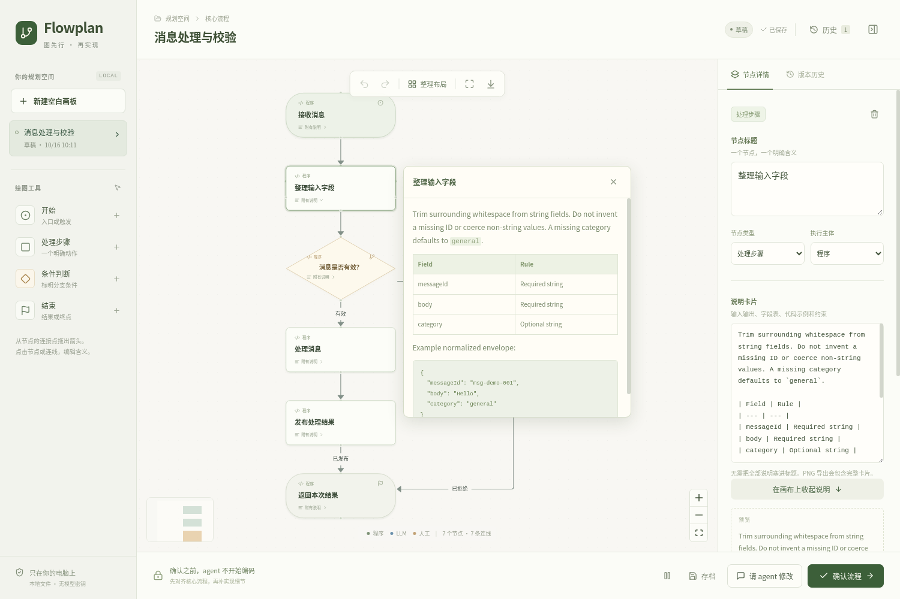
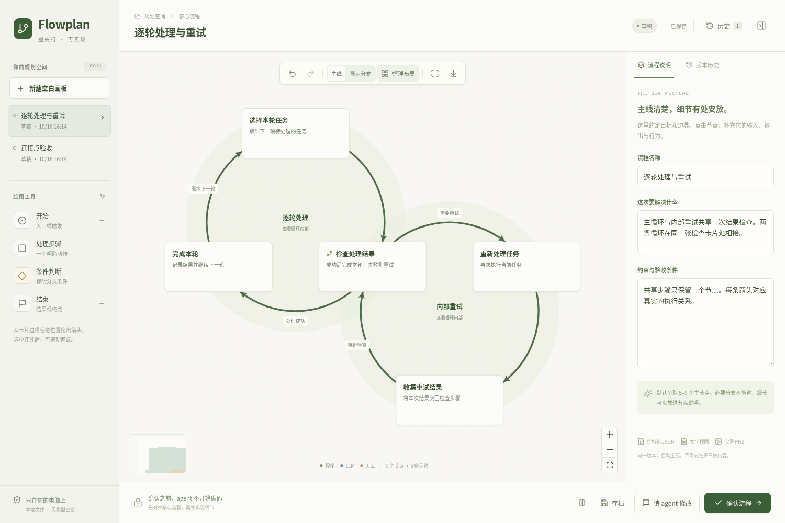
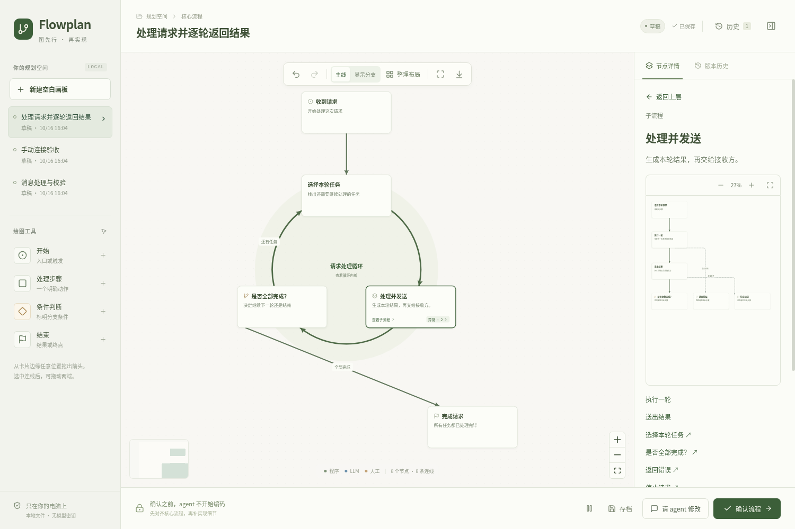

# Using Flowplan

[Back to README](../README.md) · [中文首页](../README.zh-CN.md)

## Requirements

- macOS or Linux with Python 3.8+. Native Windows is not supported because storage uses POSIX file locking and file operations.
- A modern desktop browser on the same machine as the agent. Chromium on macOS has been tested. SSH-only sessions and remote agent containers need a separate access setup that this version does not provide.
- For the skill workflow, an agent that can load `SKILL.md`, run local Python commands, and read files and images. The editor itself does not connect to a model.

The interface is currently in Chinese. Diagram labels and Markdown notes accept Unicode text.

## Manual installation

The [skills CLI](https://github.com/vercel-labs/skills) can install directly from the repository:

```sh
npx skills add dingdinglz/diagram-skill --skill diagram-plan
```

For a specific agent, use the installer's `--agent` option. Add `--global` if you want a user-wide installation instead of a project installation. The installer has its own Node.js requirement; Flowplan's runtime does not need Node.

To install without Node, clone the repository:

```sh
git clone https://github.com/dingdinglz/diagram-skill.git
```

Copy the entire `skills/diagram-plan/` directory into your agent's skills directory. For agents that use `~/.agents/skills/`, for example:

```sh
mkdir -p "$HOME/.agents/skills"
cp -R diagram-skill/skills/diagram-plan "$HOME/.agents/skills/"
```

Use the directory documented by your agent if it differs. Keep `scripts/`, `references/`, `web/`, and the third-party notices together with `SKILL.md`. Copying just the Markdown file won't install the editor. When updating an existing installation, back it up and replace the complete skill directory.

Reload skills or restart your agent as required by its host, then explicitly ask it to use `diagram-plan` for the task. You can choose manual drawing or an agent-generated first draft.

## Working in the canvas

Add nodes from the left toolbar. Drag from a node's connection point to another node to draw an arrow. Select a node to read its details, then choose **编辑节点** to edit its title, type, execution responsibility, and notes. Select an arrow to label a branch condition.

Notes support Markdown paragraphs, lists, field tables, and fenced code in the fixed right inspector. Raw HTML and embedded images are not supported.

Reading notes or opening a branch keeps the node's size, connection points, edge paths, and canvas view in place. Viewing does not save a draft, change the task revision, or enter undo/redo history. Content edits and autosave preserve the current view; switching tasks or historical versions resets it to that graph's saved defaults. PNG exports always include all notes.



Undo and redo work within the current editing session. Auto-layout only runs when you choose it. Before approving, give each decision at least two outgoing branches and label the conditions.

The main actions are:

| Button | Result |
| --- | --- |
| 请 agent 修改 | Saves the current graph, PNG, and feedback. The canvas becomes read-only while the agent revises it. |
| 确认流程 | Opens the approval dialog. Final confirmation freezes a version for implementation. |
| 存档 | Saves a version with JSON, Markdown, and PNG, without approving it. |
| 暂停本次规划 | Keeps the draft and stops the planning session without authorizing implementation. |

Cancelling a pending revision returns the canvas to editing and invalidates that request. A late agent reply cannot overwrite the newer draft.

## Reopen a task

The skill directory and the project directory have different roles. The former contains the installed tool; the latter contains the task you are planning.

```sh
SKILL_DIR="/absolute/path/to/installed/diagram-plan"
PROJECT="/absolute/path/to/your/project"
SCRIPT="$SKILL_DIR/scripts/diagram.py"

python3 "$SCRIPT" start --project "$PROJECT"
```

Select an existing task from the sidebar. To create a blank one:

```sh
python3 "$SCRIPT" create --project "$PROJECT" --title "New task" --mode manual
```

To stop the local server without deleting plans:

```sh
python3 "$SCRIPT" stop --project "$PROJECT"
```

Closing a tab saves no approval and cancels no task. Reopen the workspace with `start` when you need it again.

## If the agent doesn't continue

Browser events cannot reliably wake an agent whose turn has ended. After submitting feedback or approving, return to the conversation and say:

> Continue the diagram-plan task we were reviewing.

Include the task ID if the agent has lost context. It can recover state with `show` and check for a handoff with `wait`:

```sh
python3 "$SCRIPT" show --project "$PROJECT" --task "$TASK_ID"
python3 "$SCRIPT" wait --project "$PROJECT" --task "$TASK_ID" --timeout 25
```

Waiting is bounded. A pending result means the user is still editing; it is not approval. The skill instructs the agent to wait before modifying project code, but it cannot enforce tool permissions across every agent host.

## Saved versions and exports

Plans live under `<project>/.diagram-skill/tasks/<task-id>/`. The current draft autosaves separately from version history. Initial drafts, feedback submissions, agent revisions, checkpoints, approvals, and restorations leave snapshots.

An approval records:

- `diagram.json`: nodes, connections, positions, conditions, and notes.
- `diagram.md`: a generated text view for the agent.
- `diagram.png`: a browser-rendered view of the full flow with all notes included.

Initial and agent-revision snapshots may have no PNG until the browser renders a handoff. The agent does not generate placeholder images. If rendering fails, approval does not complete and the draft remains available.

Open history to inspect or download a version. Restoring it creates a new draft without changing the old snapshot. If coding has already started, ask the agent to pause before changing the plan; editing the canvas does not interrupt it automatically.

## Privacy and troubleshooting

Add `.diagram-skill/` to the target project's `.gitignore`. Do not share `server.json`, a token-bearing browser URL, or a task directory containing private notes. History retains content removed from later drafts.

The Python server binds to loopback and serves the bundled assets locally. It uses a session token and checks browser origin and host headers. Files are not encrypted, and normal filesystem permissions and backups still apply. Your agent may send the plan to its configured model provider when it reads it.

- **Session expired:** run `start` again and open the new URL. Stored tasks remain intact.
- **Version conflict:** keep or download your local edits before reloading. The editor offers a JSON backup before replacing unsaved changes with the server's version.
- **PNG export too large:** reduce the scope or tidy the layout. Exports are limited to 8,192 pixels per dimension, 16 Mi-pixels, and 5 MiB. Nothing is silently cropped to make approval pass.
- **Browser won't open:** use the exact URL returned by `start` or `create`. A browser on another machine cannot use the same localhost URL.

For command options, see the [CLI reference](../skills/diagram-plan/references/cli.md). The [history reference](../skills/diagram-plan/references/history.md) describes the revision and approval rules in more detail.

## Main flow, loops and reading details

New v2 plans distinguish the main flow from secondary and exception paths. Actual loop steps sit around a circle, and nested loops remain visible. Smaller loops can sit outside larger ones and touch at a shared card. Logical nesting does not require one circle to contain the other. Double-click a subflow card, or use its **进入** action, to work inside it on the main canvas at full size; the breadcrumb and `Esc` lead back out, and each level remembers its viewport. The level map under the breadcrumb lists every level from the main flow down, with a small thumbnail marking where the next level sits; click a row to jump there, or use the `第 N 层` control to hide it. Dashed cards at the edge of a level are its real outside connections; clicking one jumps to that step. A branch button opens the relevant alternate path with its entry and outcome in the inspector. The display toggle in the existing canvas toolbar shows secondary paths without saving a change.





Cards use a title and short summary. Click a card to read complete Markdown notes in the fixed right inspector; choose **编辑节点** to change content. Reading, scrolling, branch navigation and display toggles do not create revisions or use undo/redo history. The default program label is omitted from repeated cards; the inspector retains executor information.

The existing sidebar and toolbar locations remain. The palette is unchanged; typography, card boundaries and selection styling are refined. Complete PNG exports contain the main diagram, separate branch/subflow diagrams, full notes and every edge condition.

In **编辑节点**, change **显示分类** to correct the main/support/exception classification.

Building a flow by hand:

- **Keep going:** with a card selected, the bottom dock adds the next node already connected to it, with its name ready to type. Press `Esc` twice to clear the selection and add an unconnected node.
- **Insert:** with a connection selected, the dock places the new node in the middle of it. The condition stays on the first half.
- **Edit in place:** double-click a card to edit its text. **完整说明** has a Markdown preview. Drawing an exit from a decision moves focus to its condition.
- **Reverse:** select a connection and choose **反转方向**.
- **Classify together:** with several cards selected, **分类** applies main/support/exception to the cards and the connections between them.
- **Import:** **新建流程 → 导入流程 JSON** opens a saved Graph file as a new draft after the same validation agents go through.

Nesting is authored directly:

- **Group existing steps:** Shift-click or Shift-drag to select cards, then choose **组成子流程** (`⌘/Ctrl G`). The new subflow belongs to the level you are on, so groups can nest to any depth.
- **Start empty:** **子流程** in the bottom dock adds a subflow holding one new step.
- **Move steps:** drag a card onto a subflow card to move it in, or use **移入子流程** in the node editor. Inside a level, select cards and choose **移到上一层**, or use **移出** under **所属分组**. Removing membership in a parent also removes membership in its descendants. A node can belong to several groups, and its connections are never changed by these moves.
- **Connect:** dragging a connection to or from a subflow card creates a real edge to its first or from its last step. Open the subflow to change which inner step it uses.
- **Dissolve:** **解散子流程** (`⌘/Ctrl Shift G`) removes only the summary. Its steps expand in place at the level above and later cards move down to make room.

- **Loops:** select the cards on the route and choose **组成循环**; the order comes from their connections and the cards move onto a circle. If they form a line that is not yet closed, **补回边成环** also adds the closing connection. A subflow converts in either direction in its editor, which also sets its size and its subflow/branch type. Drag a loop's caption to move the whole ring.

Steps on a loop's closed route cannot be grouped into a subflow, because that would break the route. Dragging a shared card moves only that card; **整理布局** arranges the loops again. Deleting or reconnecting a required loop edge changes that group to a subflow so the diagram no longer claims a closed cycle.

Selecting a connection also offers **显示分类**: main paths use bold solid lines, support paths use fine solid lines, and exception paths use fine dashed lines. Main loop connections receive extra weight. The editor, right-side diagrams and PNG export share these styles; agents select them through `edge.role` and loop groups.

V1 tasks and immutable history remain usable. Upgrade a selected copy when reorganizing an old diagram; do not migrate every stored task just to read it. The agent follows the bundled [writing guide](../skills/diagram-plan/references/writing.md) and can apply an installed humanizer skill. The browser needs no model connection or additional skill installation.

After updating the skill's Python scripts, restart that project's diagram server with the CLI's `stop` and `start` commands. Open the URL returned by `start` to authenticate the new session. Refreshing a page loads new web assets but does not reload a running Python server.
